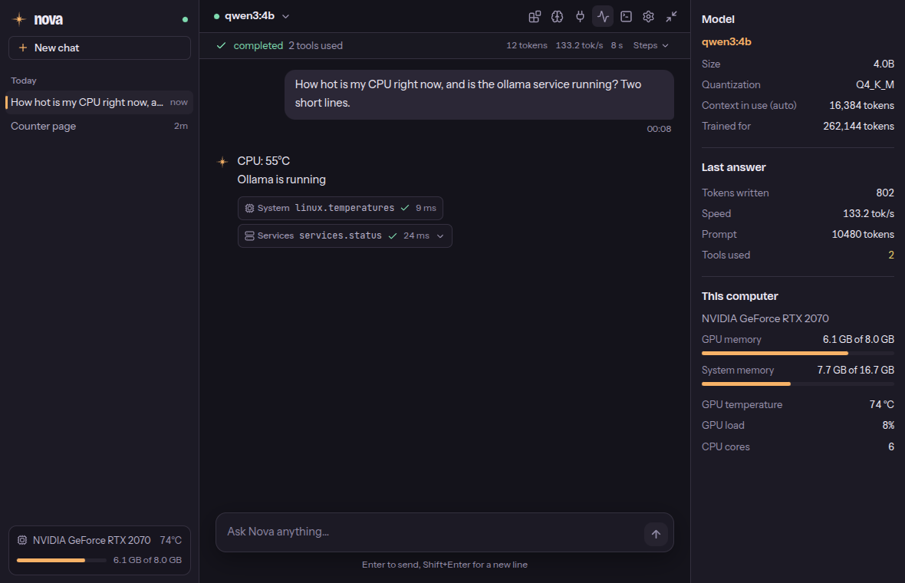
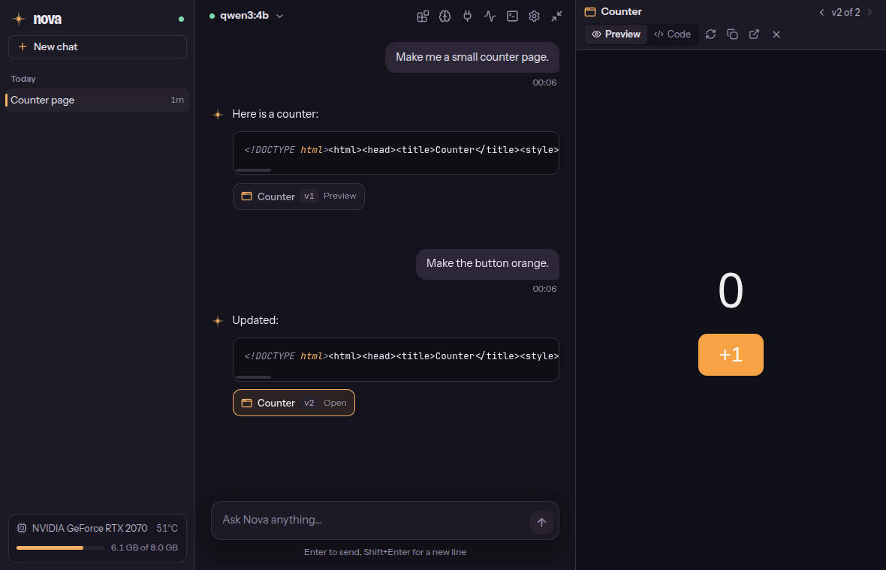

# Nova

**A local-first AI desktop assistant for CachyOS and KDE Plasma.**

Nova is a chat app that runs language models on your own GPU through
[Ollama](https://ollama.com) and can look at and act on your machine through
a set of controlled tools: system information, files in your home folder,
systemd services, a shared terminal, web search via your own SearXNG, MCP
servers and installable skills. Nothing leaves your computer unless a tool
you approved or enabled sends it.

Every tool has a risk level. Reading runs freely, changes ask for your
approval, and destructive actions always ask. The model never gets an
unrestricted shell.





## Features

**Chat**
- Streaming answers with stop and regenerate, Markdown and code highlighting, copy buttons
- Conversation history in SQLite, with automatic titles
- Model picker built from your installed Ollama models and their capabilities
- Tool use on any model: native tool calls, or a text fallback for models without them (their JSON never shows in the chat)
- Automatic context size: the largest that keeps the selected model fully on your GPU, with token counts calibrated per model
- HTML artifacts in a sandboxed side panel, with revisions (‹ v2 of 3 ›)
- Memory: "remember that…" saves a fact after you confirm; relevant facts come back in later chats

**Tools** (each one shown in the chat with its kind: System, Files, Web, Skill, Shell, MCP…)
- System: CPU, memory, GPU and VRAM, disks, uptime, top processes, temperatures
- Services: list systemd services, status with recent logs; start/stop/restart your user services after asking
- Files: list, read (with jump-to-passage) and search in your home folder; keys, credentials and browser profiles are blocked
- Web: search through your own [SearXNG](https://docs.searxng.org), fetch pages
- Shell: one persistent shell, shared with the embedded terminal (Ctrl+T); every command asks first
- Skills: installable `SKILL.md` + `tools.py` packages, toggled in the Skills panel; the model can write new ones (always confirmed, with the code shown). Skills can return polished reports that open in the side panel at once while the model explains them. Bundled: **System doctor** (what went wrong since boot: failed services, errors by source, crashes, out-of-memory kills, boot time)
- MCP: connect any stdio [MCP](https://modelcontextprotocol.io) server (GitHub setup form included)

**Desktop**
- Global show/hide shortcut, set in Settings and registered with KDE
- Compact mode (Ctrl+M), always on top, close to tray
- Live inspector: model, context, speed, GPU/VRAM, temperatures
- "Night sky" dark theme; keyboard and screen-reader friendly (axe-audited)

## Requirements

- Linux; developed and tested on CachyOS with KDE Plasma 6 (Wayland)
- [Ollama](https://ollama.com) at `localhost:11434` with at least one model. On an 8 GB GPU, `qwen3:4b` is the default and the fastest tested:

  ```bash
  ollama pull qwen3:4b
  ```

- Optional: SearXNG at `localhost:8888` with the JSON format enabled (for web search), Docker (for the GitHub MCP server)

## Installation

### As a package (CachyOS / Arch)

```bash
git clone https://github.com/hankaliss/nova.git
cd nova/packaging/arch
makepkg -si
```

This builds the committed state of the repository into a pacman package and
installs its dependencies from the official repos (`electron44`,
`python-httpx`, `python-pydantic`, `python-mcp`, `python-dbus-fast`). Nova
then appears in the application menu, and `nova` starts it.

- Update: `git pull`, then `makepkg -si` again
- Remove: `sudo pacman -R nova` (settings, chats and memories in your home folder are kept)

### From source (development)

Needs Python 3.12+ and Node.js 22+.

```bash
git clone https://github.com/hankaliss/nova.git
cd nova

python -m venv .venv
source .venv/bin/activate
pip install -e ".[dev]"          # Python backend + test tools

cd electron && npm install        # Electron UI
cd ..

nova                              # rebuilds the UI if needed, then starts Nova
```

## Using Nova

| Action | How |
|---|---|
| Pick a model | Model menu at the top left |
| New chat | Ctrl+N |
| Terminal (shared with the model's shell) | Ctrl+T |
| Compact window | Ctrl+M |
| Inspector | Ctrl+I |
| Show/hide from anywhere | Settings → General → Show/hide shortcut |
| Skills, memories, MCP servers | Icons in the header |

**Global shortcut.** In Settings → General, click the shortcut field, press
the keys, then Save. Nova registers it with KDE (it then also appears in
System Settings → Shortcuts under "Nova") and tells you if the key is
already taken. It works while Nova runs, including hidden in the tray. To
also start Nova with a key, bind `nova --toggle` in System Settings →
Keyboard → Shortcuts → Add New → Command or Script (with a different key).

**MCP servers.** Click the plug icon → *Add GitHub server* or *Add custom
server*. Nova writes `~/.config/nova/mcp.json`, starts the server and lists
its tools; every call goes through the permission flow. The GitHub server
logs in through your browser (OAuth) or uses a personal access token. Each
enabled tool costs context in every prompt, so enable only what you need. Manual configuration,
authentication modes and risk rules: [docs/mcp.md](docs/mcp.md).

## Architecture

```text
┌──────────────────────────── Electron ────────────────────────────┐
│  Renderer (React + TypeScript)        Main process (main.cjs)    │
│  chat, panels, settings  ◄── IPC ──►  window, tray, shortcut,    │
│  (sandboxed, no Node)                 trust boundary             │
└──────────────────────────────────────────┬───────────────────────┘
                                           │ JSON-RPC over stdio
┌──────────────────────────────────────────▼───────────────────────┐
│  Python sidecar (python -m nova.rpc)                             │
│                                                                  │
│  Agent ──► LLM provider (Ollama: streaming, tool calls,          │
│    │        per-model context fitting)                           │
│    ▼                                                             │
│  Tool registry ──► Permission system (READ / WRITE / DESTRUCTIVE)│
│    │                                                             │
│    ├─ system, services, files, web, shell, memory tools          │
│    ├─ skills (SKILL.md + tools.py)                               │
│    └─ MCP servers (stdio)                                        │
│                                                                  │
│  SQLite store: conversations, settings, grants, memories (FTS5)  │
│  KDE: global shortcut via kglobalaccel (D-Bus)                   │
└──────────────────────────────────────────────────────────────────┘
```

- **The UI never runs commands.** The renderer is sandboxed and only talks to the main process, which forwards calls to the Python sidecar.
- **Every tool call goes through the registry and the permission system.** Model output is treated as untrusted: READ tools run, WRITE tools ask (unless you chose "always allow"), DESTRUCTIVE tools always ask.
- **The agent keeps the prompt inside the model's context window.** History is fitted to the window, and tool results are capped.
- **Artifacts render in a sandboxed iframe** with no access to Nova or your files.

The full design, with every architecture decision (AD-001 … AD-038), is in
[ARCHITECTURE.md](ARCHITECTURE.md).

## Tech stack

| Layer | Technology |
|---|---|
| Desktop shell | Electron 44 (run through XWayland) |
| UI | React 18, TypeScript, Tailwind CSS 4, Vite 6 |
| UI libraries | marked + highlight.js + DOMPurify (Markdown), xterm.js (terminal), lucide (icons) |
| Backend | Python 3.12+ (asyncio), Pydantic, httpx |
| LLM runtime | Ollama (default model `qwen3:4b`) |
| Storage | SQLite with FTS5 |
| Integrations | MCP Python SDK, dbus-fast (KDE kglobalaccel), systemd, SearXNG |
| Tests | pytest + pytest-asyncio, Vitest; GitHub Actions CI |
| Packaging | Arch PKGBUILD |

## Project layout

```text
src/nova/        Python backend: agent, llm, tools, security, skills,
                 memory, mcp, shell, kde, rpc (the sidecar)
electron/        Electron main + preload, React renderer in electron/src
skills/          bundled skills
tests/           pytest suite
packaging/       Arch PKGBUILD and .desktop entry
docs/            screenshots
agent.md         bundled system prompt
```

## Configuration and data

| What | Where |
|---|---|
| Settings, chats, memories | `~/.local/share/nova/nova.db` (SQLite) |
| Your own skills | `~/.local/share/nova/skills/` |
| System prompt override | `~/.config/nova/agent.md` (editable in Settings) |
| MCP servers | `~/.config/nova/mcp.json` |
| Terminal prompt (optional) | `~/.config/nova/starship.toml` |

## Development

```bash
python -m pytest -q            # backend tests (no GPU or Ollama needed)
cd electron && npm test        # UI unit tests (Vitest)
cd electron && npx tsc --noEmit
```

CI runs all of these on every push. Conventions and workflow are in
[DEVELOPMENT.md](DEVELOPMENT.md), and the current state, known issues and
next steps are tracked as [issues](https://github.com/hankaliss/nova/issues)
on the "Nova" project board.

## Status

Early development (v0.0.1). No license has been chosen yet.
